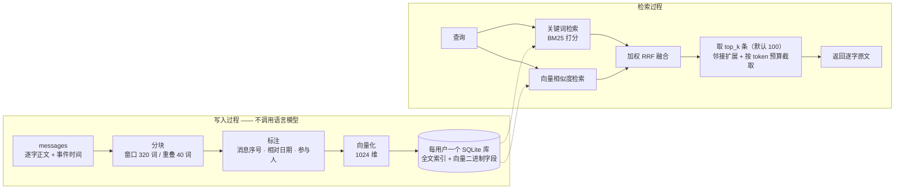

# Verbatim 逐字记忆

**一套自行部署的长期记忆服务，面向 Agent（能自主调用工具、连续完成多步任务的 AI 程序）。对话中的每条消息都逐字保存，检索时同时使用关键词匹配与向量相似度。**

[](LICENSE)

[](https://agentmemories.ai/competition)

服务以单进程运行，基于 FastAPI（Python 的 Web 框架）与 SQLite（单文件嵌入式数据库）。部署时不需要外部数据库，不需要消息队列，也不需要单独运维一套向量检索服务。

*A self-hosted memory service for AI agents. Every message is kept word for word; retrieval is hybrid
(BM25 + vectors). One container, one process, one directory of SQLite files. English summary at the bottom.*

---

## 这个服务是什么，不是什么

| 这个服务提供 | 这个服务不提供 |
| --- | --- |
| 一套自行部署的 Add / Search HTTP 接口 | 托管式的记忆云产品 |
| 逐字保存、只追加、带完整出处的存储 | 把对话压缩成「记忆卡片」的摘要器 |
| 混合检索（hybrid retrieval，指对同一个查询同时执行关键词检索与向量检索，再把两份排名合并） | 替使用者生成答案的语言模型外壳 |
| 一个容器、一个进程、一个存放 SQLite 文件的目录 | 集群、消息队列，或托管向量数据库 |

## 快速开始

```bash
git clone https://github.com/xiaomijituan/agent-memory-service
cd agent-memory-service
cp .env.example .env          # 填写 AMC_MEMORY_SYSTEM_KEY 与嵌入模型服务地址
docker build -t agent-memory-service:local .
docker run -d --name agent-memory-service \
  --env-file .env \
  -p 8080:8080 \
  -v "$PWD/data:/var/lib/amc/data" \
  agent-memory-service:local
curl --fail http://127.0.0.1:8080/healthz
```

不接入任何嵌入模型（embedding model，指把文本转换成向量的模型）提供方，服务也能运行：把 `AMC_EMBEDDING_MODE` 设为 `off`，检索就只使用关键词匹配，**全程不发出任何出站请求**。在内网隔离环境，或者要求结果可复现的场合，建议直接使用这一模式。

> 镜像以非 root 用户运行，数据目录的属主必须是用户 ID（uid）`10001`。
> 如果你挂载的目录是用 root 创建的，请在首次启动前执行 `chown 10001:10001 <目录>`。

## 评测成绩（初步读数，官方审核中）

Verbatim 为 **Agent Memory Challenge 2026** 开发，并在该赛事的统一评测平台上完成了一次完整评测。下表是平台返回的读数。

| 项 | 值 |
| --- | --- |
| 赛事 | Agent Memory Challenge 2026（中国图象图形学学会 CSIG 主办，Agent Memory Leaderboard 统一评测） |
| 赛道 / 榜单 | 文本赛道 · 工业榜（商业产品榜） |
| 参评版本 | `v1.4` |
| 模式 | `full`（完整评测，非抽样） |
| 完成时间 | 2026-10-24 |
| 判分题量 | **9,602 / 9,602**，全部判完 |
| 平台返回的初步总分 | **0.5167**（即 51.67 / 100） |

以下三点限定了这个分数的含义，引用分数时必须一并说明：

1. **这是初步读数，不是最终成绩。** 主办方正在审核，正式成绩、排名与获奖名单由主办方公布，
   以 <https://agentmemories.ai/leaderboard/industry/textual> 为准。本仓库不宣称任何名次。
2. **这个分数只能与同为 `full` 模式的读数比较。** 抽样模式（`smoke`）与本地自测的题目构成不同，
   两者的总分不具备可比性。
3. 本次评测由同一个任务从中断处继续执行并完成，参评版本、模型与算法全程未变，也没有新建第二次完整评测。

## 为什么叫「逐字」

多数 Agent 记忆系统采用压缩策略：先把一段对话总结成一张记忆卡片，再对摘要建立向量索引，后续对话中把摘要作为上下文返回。这样做的存储与计算成本很低，但会丢失 Agent 真正需要的三类信息：

- **数字与名字**——`预算是 12,480` 被摘要保留下来的概率，远低于 `当时提到过预算`。
- **说话人**——摘要会把两个人合并成一个声音，系统因此无法正确回答关于个人偏好的问题。
- **时间**——`上周六` 只有在原始时间戳与原始措辞都保存下来时，才能还原成具体日期。

因此，逐字记忆采取相反的做法：**每条消息逐字入库、只追加，把工程投入放在检索环节，而不是放在改写环节。** 写入过程中不调用语言模型生成任何文本。服务运行时唯一使用的模型是嵌入模型，嵌入模型只用于给文本建立索引，不用于替换文本。

这样做的结果是：一条记忆是可以逐字核对的事实，而不是一段只能选择相信的转述。

## 接口

服务对外提供两个读写接口与两个运维接口。请求与响应都是 JSON；身份验证只使用一个请求头 `Authorization: Token <AMC_MEMORY_SYSTEM_KEY>`。

| 方法 | 路径 | 用途 |
| --- | --- | --- |
| `POST` | `/v1/memories/add` | 把一批消息写入指定的用户与会话命名空间（namespace，指相互隔离的数据范围） |
| `POST` | `/v1/memories/search` | 按查询召回逐字片段 |
| `GET` | `/healthz` | 返回服务是否存活，以及依赖组件的状态 |
| `GET` | `/version` | 返回本次构建固定的版本指纹，即一串记录版本号与关键参数的文本 |

**写入**

```bash
curl -X POST http://127.0.0.1:8080/v1/memories/add \
  -H "Authorization: Token $KEY" -H 'Content-Type: application/json' \
  -d '{
    "request_id": "demo-1",
    "user_id": "u_demo",
    "session_id": "s_demo",
    "messages": [
      { "role": "user", "content": "Our flight lands next Saturday.", "timestamp": 1684468800000 },
      { "role": "assistant", "content": "Noted — I will keep the itinerary." }
    ]
  }'
```

```json
{ "success": true, "request_id": "demo-1", "user_id": "u_demo", "session_id": "s_demo" }
```

**读取**

```bash
curl -X POST http://127.0.0.1:8080/v1/memories/search \
  -H "Authorization: Token $KEY" -H 'Content-Type: application/json' \
  -d '{ "request_id": "demo-2", "user_id": "u_demo", "query": "when does the flight land", "top_k": 5 }'
```

响应形状如下（`id` 与 `score` 是示例值）：

```json
{
  "data": [
    {
      "id": "1",
      "content": "Our flight lands next Saturday (2023-05-20).",
      "score": 0.032787,
      "created_at": "2023-05-19T04:00:00Z"
    }
  ]
}
```

三条容易出错的约定：

- 消息的 `timestamp` 使用 Unix **毫秒**时间戳；`created_at` 由 `timestamp` 换算得到，输出格式为 `YYYY-MM-DDTHH:MM:SSZ`。
- `role` 接受任何非空字符串。真实的 Agent 对话记录里包含 `system` 轮次，记忆服务不应拒收这类消息。
- `score` 是融合之后的排序分，来自倒数排名融合（reciprocal rank fusion，简称 RRF，指按候选在两份排名中的名次计算分数再相加）。
  排序分不是相似度百分比，不应把排序分当作置信度使用。

## 一条记忆如何写入、如何被检索到



关键词检索使用 BM25（一种按词频与文档长度计算相关性的打分算法），由 FTS5（SQLite 内置的全文索引扩展）提供。以下三个细节决定了检索质量：

1. **融合，而不是二选一。** 关键词排名与向量排名通过加权倒数排名融合合并，常数 `RRF_CONSTANT = 60`。
   因此，名字精确命中的候选与语义近似命中的候选都能影响最终排名。
2. **邻接扩展。** 一条消息命中之后，服务会把同一会话中与该消息相邻的消息一并返回
   （邻接半径为 1，参与扩展的命中消息最多 20 条）。这样做的原因是：答案后面那句话，往往正是答案成立的条件。
3. **时间在检索时才展开。** `next Saturday` 连同该消息的事件时间戳一起入库，返回时展开成
   `next Saturday (2023-05-20)`，**原始措辞永不被覆盖**。
   目前只识别英文时间短语（`yesterday`、`next Saturday`、`two weeks ago`、`this weekend` 等）；
   中文时间表达按原文保留，不做展开。

返回之前还有一道按 token 预算截取的处理（token 是模型计算文本长度与费用的单位）：单条内容超过 14,720 token 会被压缩到该上限；整批内容的累计长度一旦要超过 117,760 token，服务就停止追加后续候选。**排序即截断**——排在后面的内容不是被降低权重，而是根本不会出现在响应里。因此，两个检索分支的融合权重值得认真调整。

## 设计取舍

| 决定 | 为什么这样决定 |
| --- | --- |
| 只追加，永不摘要 | 无法逐字引用的记忆，也就无法调试 |
| 每个用户一个 SQLite 库，按哈希前缀分散到 256 个目录 | 租户隔离不需要额外机制：不存在跨租户读取数据的通道，删除一个租户就是删除一个文件 |
| 幂等（idempotent，指同一请求重复发送多次，结果与发送一次相同）以 `request_id` 为键 | Agent 运行时重试是常态。重放同一请求返回已保存的内容；同一 `request_id` 携带不同内容则返回 `409` |
| 过载时返回 `429` 与 `Retry-After`，而不是无上限排队 | 会退避（backoff，指收到拒绝后等待一段时间再重试）的调用方能够恢复；会超时的调用方只会立即重试，使过载进一步恶化 |
| 单工作进程（worker），并发上限在进程内实施 | 启动恢复逻辑假定一个数据目录只由一个进程读写。这样换来实现上的简单，代价是必须把并发上限说清楚 |
| 检索全程不调用语言模型 | 降低延迟与成本，更重要的是保证一轮评测可以复现 |
| 使用 FTS5，而不是独立的向量数据库 | 备份只需要一个文件，排查问题时只需要面对一个进程，关键词打分与向量检索在同一个查询规划器（数据库内部决定如何执行查询的组件）里完成 |

## 配置

全部配置项都由环境变量驱动，完整清单见 [`.env.example`](.env.example)。下表中的变量会改变服务行为，而不只是改变部署方式：

| 变量 | 默认值 | 作用 |
| --- | --- | --- |
| `AMC_AUTH_SCHEME` / `AMC_MEMORY_SYSTEM_KEY` | `token` | 把 `AMC_AUTH_SCHEME` 设为 `none` 可关闭身份验证，只适用于本地开发 |
| `AMC_EMBEDDING_MODE` | 无默认值，**必须显式设置** | 取值为 `api` 或 `off`；未设置时服务拒绝启动。`.env.example` 给出的取值是 `api` |
| `AMC_EMBEDDING_DIMENSIONS` | `1024` | 必须与嵌入模型提供方的输出维度一致 |
| `AMC_ADD_CONCURRENCY` / `AMC_SEARCH_CONCURRENCY` | `8` / `2` | 进程内同时处理的写入 / 检索请求数上限 |
| `AMC_ADMISSION_WAIT_SECONDS` | `10` | 超出上限后最多等待多少秒，等待超时返回 `429`；`0` 表示立即拒绝 |
| `AMC_REQUEST_TIMEOUT_SECONDS` | `1800` | 一个尚未完成的写入请求所占用的处理名额，最长保留多少秒 |
| `AMC_CHUNK_WINDOW_WORDS` / `_OVERLAP_WORDS` / `_STRIDE_WORDS` | `320` / `40` / `280` | 分块的窗口长度、重叠长度与步长，单位是词 |
| `AMC_FUSION_WEIGHT_LEXICAL` / `_VECTOR` | `1.0` / `1.0` | 关键词检索与向量检索在融合时的权重 |
| `AMC_MAX_OPEN_DBS` | `32` | 同时保持打开状态的 SQLite 数据库句柄数 |
| `AMC_SHAPE_PROBE` | `off` | 可选的调用形状统计，记录调用方发送的请求形态，用于排查集成问题 |

## 实测得到的运行边界

- **并发**：服务端的写入 / 检索上限默认是 Add 8 与 Search 2，而评测平台实际发送的并发是 **16 / 16**，`top_k` 固定为 100。
  这两个数值必须一并理解：超出服务端上限的请求先等待最多 10 秒，仍无法进入处理时返回 `429`。
  也就是说，超额请求会先排队，而不是立即收到错误。
- **`top_k`**：默认值为 100，这也是评测接口约定允许的上界。**服务本身不限制 `top_k` 的最大值**，
  因此面对不可信调用方时，请自行设置上限（`top_k <= 0` 会返回空结果）。
- **存储**：完整评测语料在 2 vCPU / 2 GiB 的主机上写出约 4.25 GiB 的数据目录，容器内存上限为 1.5 GiB。
  占用空间的是向量与索引，不是原文；这一分布与逐字保留原文的做法一致。
- **并发上限按进程计算**，而服务只运行一个进程。需要扩容时，请为每个租户部署一个独立实例，
  而不是在同一个数据目录上增加工作进程。
- **`DELETE` 只删除数据行，不缩小数据库文件。** 若要回收磁盘空间，需要另外执行一次 `VACUUM`
  （SQLite 重建数据库文件以回收空间的命令），或者按用户库文件清理。这是一项独立的、需要授权的操作。

## 赛事与链接

- 平台与榜单：<https://agentmemories.ai> · <https://agentmemories.ai/leaderboard/industry/textual>
- 赛事页：<https://agentmemories.ai/competition>
- 规则：<https://agentmemories.ai/rules>
- 平台要求的 Add / Search 接口约定：<https://agentmemories.ai/api-guide>
- 第二期 FAQ（评测模式、配额、模型资格）：<https://agentmemories.ai/blog?post=phase2-faq-20260920>
- 第二期补充问答（版本登记、模型披露）：<https://agentmemories.ai/blog?post=phase2-faq-part2-20261022>
- 官方数据集与评测仓库：<https://github.com/AML-memory/agent-memory-leaderboard>
- Hugging Face：<https://huggingface.co/agent-memory-leaderboard>

**模型披露**（商业产品榜要求参赛方说明模型使用情况）：服务运行时只使用**一个**模型——`text-embedding-v4`（1024 维），通过在线嵌入模型 API 调用，仅用于入库索引与查询编码。**Add 与 Search 的任何环节都不使用语言模型，也不使用重排模型（reranker，指对召回结果再做一次相关性排序的模型）。** 官方评测中的答案生成与判分，由平台自己的模型完成。

## 独立开发者与 AI 协作的实现方式

Verbatim 是一个独立项目：设计、实现与运维由同一个人完成。主体工作在大约两周的业余时间里完成，过程中大量使用 agentic AI（能自主调用工具、连续执行多步任务的 AI）。比开发速度更重要的是以下方法：

- **永远先写失败的测试。** 没有先写出一个会失败的测试，就不允许提交产品代码。
  拿不出先看到测试失败、再看到测试通过的证据，改动就不合并。
- **决定写进文件，不留在聊天记录里。** 每个不显然的选择都写成一条编号的架构决策记录（ADR），
  记录当时的背景与被否决的选项。明天接手的 AI 因此能读到当初的推理，而不只是代码。
- **进度只由一份清单记录。** 清单里每个已完成条目都附有验证证据，这份清单是判断任务是否完成的全部依据。
  “我觉得这部分做完了”不构成状态。
- **多条任务线并行，按文件划分修改权。** 多个 AI 能同时修改同一个仓库，前提是每个文件在每一项任务中
  只由一个执行者负责修改，而涉及整个仓库的命令统一由负责调度的 AI 会话执行。
- **先测量，再写入结论。** 容量、延迟、召回率与成本都在真实部署上测量过，才写进申报材料。
  几个看起来合理的设计因为测量不出收益而被放弃，其中包括一个「判别式证据层」
  （指在检索之后对证据再做一次判定，删除或折叠判定为不相关、或已被取代的内容）。
  这一层在消融实验（ablation，指关闭某个组件后重新测量分数）中使总分下降，因此被删除。
- **AI 写了很大一部分代码；每一个不可回退的决定，都由人来负责。**

如果你想借鉴的是方法而不是代码，值得借鉴的是以下三条：先写失败的测试、把决定写成架构决策记录、以及不发布任何没有测量过的结论。

## 仓库结构

```
app/                 服务代码
  api/add.py         写入：校验、幂等占位、分块、标注、向量化
  api/search.py      检索：两个分支、融合、邻接扩展、按 token 预算截取
  store.py           每用户 SQLite：表结构、全文索引、向量、事务
  retrieval/         lexical.py · vector.py · fusion.py
  chunking.py        annotate.py        relative_dates.py     participants.py
  auth.py            concurrency.py     config.py             versioning.py
  health.py          retention.py       embedding.py          logging.py
deploy/              requirements.txt · sqlite_gate.py
tests/test_smoke.py  针对运行中实例的冒烟测试（只验证最基本功能是否可用）
Dockerfile           非 root 镜像、健康检查、单工作进程
.env.example         全部受支持的配置项
```

## 安全说明

- 除 `/healthz` 与 `/version` 外，所有接口都要求携带令牌（bearer token，指持有即可通过验证的凭据）。
  令牌缺失或错误时返回 `401`，响应体不回显密钥。
- 日志只记录标识符（`request_id`、`user_id`、`session_id`）、状态码与耗时，不记录任何凭据。
- `.env` 已被 git 忽略，仓库只发布 `.env.example`。
- 服务没有管理控制台，没有枚举用户的接口，也不存在由请求文本拼接而成的 SQL 语句。

## English summary

**Verbatim** is a self-hosted long-term memory service for AI agents. It stores every message word for word,
append-only, and puts the engineering effort into retrieval rather than into rewriting. The write path never
generates text with a language model; the only model in the running service is an embedding model used for
indexing. Reads run two legs — BM25 over SQLite FTS5 and vector similarity — merged with weighted reciprocal
rank fusion (`RRF_CONSTANT = 60`), then expanded with same-session neighbours and packed under a token budget.
Relative dates are resolved at read time, so the original wording is never overwritten (English phrases only).

One container, one process, one directory of per-user SQLite files spread over 256 hash-prefixed buckets.
No external database, no queue, no vector service to operate. `AMC_EMBEDDING_MODE=off` runs it fully lexical
with zero outbound calls.

Built for the **Agent Memory Challenge 2026** (CSIG, Agent Memory Leaderboard), textual track /
commercial-product leaderboard. One complete `full` evaluation finished on 2026-10-24 with all
**9,602 / 9,602** questions scored; the platform returned a **preliminary** total of **0.5167**.
Official review is in progress — final results, rankings and awards are published by the organizers at
<https://agentmemories.ai/leaderboard/industry/textual>, not here. Only the embedding model
`text-embedding-v4` (1024-dim) is used; no LLM and no reranker anywhere in Add or Search.

Solo project, built test-first with heavy agentic-AI use: decisions live in numbered architecture records,
progress lives in one evidence-bearing ledger, and every claim about capacity or quality was measured on the
real deployment before it was written down.

## 许可证

Apache-2.0，全文见 [LICENSE](LICENSE)。

内部设计文档、评测语料与逐题结果数据不包含在本仓库中。