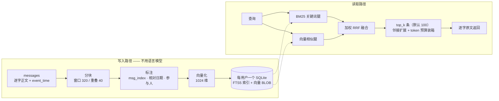

# Verbatim 逐字记忆

**自部署的 Agent 长期记忆服务：告诉过它的话，逐字留着；要用时按意思找回来，不靠运气。**

[](LICENSE)

[](https://agentmemories.ai/competition)

单进程 · FastAPI + SQLite · 不需要外部数据库，不需要编排层，不需要单独运维一套向量服务。

*A self-hosted memory service for AI agents. Every message is kept word for word; retrieval is hybrid
(BM25 + vectors). One container, one process, one directory of SQLite files. English summary at the bottom.*

---

## 它是什么，不是什么

| 它是 | 它不是 |
| --- | --- |
| 一套自己部署的 Add / Search HTTP 接口 | 托管的记忆云产品 |
| 逐字、只追加、带完整出处的存储 | 把对话压缩成「记忆卡片」的摘要器 |
| 关键词与向量双路融合的混合检索 | 替你回答问题的语言模型外壳 |
| 一个容器、一个进程、一个目录的 SQLite 文件 | 集群、消息队列，或托管向量数据库 |

## 快速开始

```bash
git clone https://github.com/xiaomijituan/agent-memory-service
cd agent-memory-service
cp .env.example .env          # 填 AMC_MEMORY_SYSTEM_KEY 与 embedding 端点
docker build -t agent-memory-service:local .
docker run -d --name agent-memory-service \
  --env-file .env \
  -p 8080:8080 \
  -v "$PWD/data:/var/lib/amc/data" \
  agent-memory-service:local
curl --fail http://127.0.0.1:8080/healthz
```

不想接任何 embedding 提供方也能跑：把 `AMC_EMBEDDING_MODE` 设成 `off`，服务退化为纯关键词检索，
**全程零出站请求**。内网隔离环境、或者要求结果可复现的场合，建议直接用这一档。

> 镜像以非 root 用户运行，数据目录要求属主是 uid `10001`。
> 如果挂载的是你用 root 建的目录，首次启动前先 `chown 10001:10001 <目录>`。

## 评测成绩（初步读数，官方审核中）

本服务为 **Agent Memory Challenge 2026** 而做，并在该赛事的统一评测平台上跑完了一次完整评测：

| 项 | 值 |
| --- | --- |
| 赛事 | Agent Memory Challenge 2026（中国图象图形学学会 CSIG 主办，Agent Memory Leaderboard 统一评测） |
| 赛道 / 榜单 | 文本赛道 · 工业榜（商业产品榜） |
| 参评版本 | `v1.4` |
| 模式 | `full`（完整评测，非抽样） |
| 完成时间 | 2026-10-24 |
| 判分题量 | **9,602 / 9,602**，全部判完 |
| 平台返回的初步总分 | **0.5167**（即 51.67 / 100） |

三条必须一起读的口径说明：

1. **这是初步读数，不是最终成绩。** 官方正在审核，正式成绩、排名与获奖名单由主办方公布，
   以 <https://agentmemories.ai/leaderboard/industry/textual> 为准，本仓库不另行宣称名次。
2. **只能与同为 `full` 模式的读数比较。** 抽样模式（`smoke`）与本地自测的题量构成不同，
   总分放在一起比没有意义。
3. 评测由同一任务断点续跑完成，参评版本、模型与算法全程未变；未新建第二次完整评测。

## 为什么叫「逐字」

多数 Agent 记忆系统走的是压缩路线：把一段对话总结成一张记忆卡片，对摘要做向量索引，日后把摘要喂回去。
这样很省，但它会悄悄毁掉 Agent 真正需要的三样东西：

- **数字与名字**——「预算是 12,480」在摘要里活下来的概率，远低于「当时提到过预算」；
- **谁说的**——摘要会把两个人合并成一个声音，于是偏好类问题再也答不对；
- **什么时候**——「上周六」只有原始时间戳和原始措辞都还在，才还原得出来。

所以这个服务押相反的一边：**每条消息逐字入库、只追加，把功夫下在检索上，而不是下在改写上。**
写入路径不用语言模型生成任何文本。运行中唯一的模型是 embedding 模型，它用来*索引*文本，从不用来*替换*文本。

结果就是：一条记忆是你可以核对的事实，而不是一段你必须相信的转述。

## 接口

两个读写接口，加两个运维接口。请求与响应都是 JSON；鉴权只有一个请求头
`Authorization: Token <AMC_MEMORY_SYSTEM_KEY>`。

| 方法 | 路径 | 用途 |
| --- | --- | --- |
| `POST` | `/v1/memories/add` | 把一批消息写进某个 user / session 命名空间 |
| `POST` | `/v1/memories/search` | 按查询召回逐字片段 |
| `GET` | `/healthz` | 存活与依赖状态 |
| `GET` | `/version` | 本次构建冻结下来的版本指纹 |

**写入**

```bash
curl -X POST http://127.0.0.1:8080/v1/memories/add \
  -H "Authorization: Token $KEY" -H 'Content-Type: application/json' \
  -d '{
    "request_id": "demo-1",
    "user_id": "u_demo",
    "session_id": "s_demo",
    "messages": [
      { "role": "user", "content": "Our flight lands next Saturday.", "timestamp": 1684468800000 },
      { "role": "assistant", "content": "Noted — I will keep the itinerary." }
    ]
  }'
```

```json
{ "success": true, "request_id": "demo-1", "user_id": "u_demo", "session_id": "s_demo" }
```

**读取**

```bash
curl -X POST http://127.0.0.1:8080/v1/memories/search \
  -H "Authorization: Token $KEY" -H 'Content-Type: application/json' \
  -d '{ "request_id": "demo-2", "user_id": "u_demo", "query": "when does the flight land", "top_k": 5 }'
```

响应形状如下（`id` 与 `score` 为示例值）：

```json
{
  "data": [
    {
      "id": "1",
      "content": "Our flight lands next Saturday (2023-05-20).",
      "score": 0.032787,
      "created_at": "2023-05-19T04:00:00Z"
    }
  ]
}
```

三个容易踩的约定：

- 消息的 `timestamp` 是 Unix **毫秒**；`created_at` 由它换算而来，输出格式是 `YYYY-MM-DDTHH:MM:SSZ`。
- `role` 接受任何非空字符串。真实的 Agent 转录里有 `system` 轮次，记忆系统不该悄悄拒收。
- `score` 是融合后的排序分（reciprocal rank fusion，倒数排名融合），不是相似度百分比，别拿它当置信度用。

## 一条记忆怎么被写下、怎么被找到



撑起质量的三个细节：

1. **融合，而不是二选一。** 关键词排名与向量排名用加权倒数排名融合合并（`RRF_CONSTANT = 60`），
   于是「名字精确命中」和「语义近似命中」都有话语权。
2. **邻接扩展。** 命中一条，就把同一会话里它的邻居一起带出来（半径 1，种子最多 20 条）——
   因为答案后面那句话，往往正是答案成立的条件。
3. **时间在读取时才展开。** `next Saturday` 连同它的事件时间戳一起入库，返回时展开成
   `next Saturday (2023-05-20)`，**原始措辞永不被覆盖**。
   目前只识别英文时间短语（`yesterday`、`next Saturday`、`two weeks ago`、`this weekend` 等）；
   中文时间表达按原文保留，不做展开。

返回前还有一道装箱：单条超过 14,720 token 会被压到该上限；整批累计一旦要超过 117,760 token 就停止追加。
**排序即截断**——排在后面的内容不是被降级，而是根本不会出现在响应里，所以融合权重值得认真调。

## 设计取舍

| 决定 | 为什么是这样 |
| --- | --- |
| 只追加，永不摘要 | 一条不能原样引回来的记忆，就是一条没法调试的记忆 |
| 每用户一个 SQLite 库，散列到 256 个前缀目录 | 隔离是白送的：没有跨租户泄漏路径，删一个租户就是删一个文件 |
| 幂等以 `request_id` 为键 | Agent 运行时重试是常态；重放返回已存的字节，同 id 换载荷则是 `409` |
| 过载回 `429` + `Retry-After`，而不是无界排队 | 会退避的调用方能恢复；会超时的调用方只会重试，把情况搞得更糟 |
| 单 worker，进程内准入闸门 | 启动恢复假定一个数据目录只有一个进程；这换来简单，代价是必须把上限说清楚 |
| 检索全程不调用语言模型 | 延迟、成本，以及最要紧的——一轮评测的可复现性 |
| 用 FTS5，而不是向量数据库 | 备份只需一个文件，推理只需一个进程，BM25 与向量在同一个查询规划器里 |

## 配置

全部由环境变量驱动，完整清单见 [`.env.example`](.env.example)。下面这些会改变行为，而不只是改变部署方式：

| 变量 | 默认值 | 作用 |
| --- | --- | --- |
| `AMC_AUTH_SCHEME` / `AMC_MEMORY_SYSTEM_KEY` | `token` | 设成 `none` 关闭鉴权——只用于本地开发 |
| `AMC_EMBEDDING_MODE` | 无默认，**必须显式设置** | `api` 或 `off`；不设置服务拒绝启动。`.env.example` 给的是 `api` |
| `AMC_EMBEDDING_DIMENSIONS` | `1024` | 必须与你的提供方一致 |
| `AMC_ADD_CONCURRENCY` / `AMC_SEARCH_CONCURRENCY` | `8` / `2` | 进程内准入上限 |
| `AMC_ADMISSION_WAIT_SECONDS` | `10` | 超额后有界等待多久，等不到就 `429`；`0` 表示立刻拒 |
| `AMC_REQUEST_TIMEOUT_SECONDS` | `1800` | 一个在途写入请求的占位寿命 |
| `AMC_CHUNK_WINDOW_WORDS` / `_OVERLAP_WORDS` / `_STRIDE_WORDS` | `320` / `40` / `280` | 分块几何 |
| `AMC_FUSION_WEIGHT_LEXICAL` / `_VECTOR` | `1.0` / `1.0` | 两条检索腿的配比 |
| `AMC_MAX_OPEN_DBS` | `32` | 同时持有的 SQLite 句柄数 |
| `AMC_SHAPE_PROBE` | `off` | 可选的调用方形状遥测，用于排查集成问题 |

## 实测出来的边界，不是估的

- **并发**：服务侧闸门默认 Add 8 / Search 2；而评测平台实发并发是 **16 / 16**，`top_k` 固定 100。
  两个数必须一起读——超额部分走有界等待（10 秒）再 `429`，姿态是排队，不是报错。
- **`top_k`**：默认 100，这也是评测契约允许的上界；**服务本身不做上限钳制**，
  所以面对不可信调用方，请自己加一道天花板（`top_k <= 0` 会返回空结果）。
- **存储**：完整评测语料在 2 vCPU / 2 GiB 的宿主上写出约 4.25 GiB 数据目录，容器内存上限 1.5 GiB。
  占空间的是向量与索引，不是原文——这与「原文逐字保留」的主张是一致的。
- **闸门是每进程的**，而服务刻意只跑一个进程。要扩容，就给每个租户一个实例，
  而不是往同一个数据目录上加 worker。
- **`DELETE` 只删行，不缩文件。** 真要回收磁盘，得另做一次 `VACUUM` 或按用户库文件清理，
  那是一个独立的、需要授权的操作。

## 赛事与链接

- 平台与榜单：<https://agentmemories.ai> · <https://agentmemories.ai/leaderboard/industry/textual>
- 赛事页：<https://agentmemories.ai/competition>
- 规则：<https://agentmemories.ai/rules>
- 平台要求的 Add / Search 接口契约：<https://agentmemories.ai/api-guide>
- 第二期 FAQ（评测模式、配额、模型资格）：<https://agentmemories.ai/blog?post=phase2-faq-20260920>
- 第二期补充问答（版本登记、模型披露）：<https://agentmemories.ai/blog?post=phase2-faq-part2-20261022>
- 官方数据集与评测仓库：<https://github.com/AML-memory/agent-memory-leaderboard>
- Hugging Face：<https://huggingface.co/agent-memory-leaderboard>

**模型披露**（商业榜要求把这件事说清楚）：运行中的服务只用**一个**模型——
`text-embedding-v4`（1024 维），通过在线 embedding API 调用，仅用于入库索引与查询编码。
**Add 与 Search 的任何环节都不使用语言模型，也不使用重排（reranker）模型。**
官方评测中的答案生成与判分，由平台自己的模型完成。

## 一个人 + AI：这套东西是怎么做出来的

这是一个独立项目：一名设计者、一名实现者、一名运维者，都是同一个人。
主体在大约两周的业余时间里完成，重度使用 agentic AI（能自主调用工具、连续执行多步任务的 AI）。
但比速度更要紧的是方法：

- **永远先写失败测试。** 没有先写出一个红测试，就不许落产品代码。拿不出「先红后绿」证据的改动，不合并。
- **决定写进文件，不留在聊天里。** 每个非显然的选择都变成一条编号的架构决策记录，
  带上背景与被否掉的那个选项——这样明天接手的那个 agent 继承到的是推理，而不只是代码。
- **进度只有一本账。** 一份任务清单，每个勾上附证据，它是「做到没有」的唯一真相来源；
  「我觉得这部分做完了」不算状态。
- **并行泳道 + 文件归属。** 多个 agent 能同时改同一个仓库，是因为每个文件在每张任务里只有一个主人，
  而仓库级命令只归协调会话执行。
- **先量，再宣称。** 容量、延迟、召回、成本都在真实部署上测过，才写进申报材料。
  几个听起来很有道理的设计因为量不出收益而被丢掉——包括一层「判别式证据层」，
  它在消融实验里让分数**更差**，于是被删掉了。
- **AI 写了很大一部分代码；而每一个不可回退的决定，都由人来负责。**

如果你想复用的是方法而不是代码，值得抄走的是这三条：先写失败测试、把决定写成架构记录、
以及拒绝发布任何没量过的结论。

## 仓库结构

```
app/                 服务本体
  api/add.py         写入路径：校验、幂等占位、分块、标注、向量化
  api/search.py      读取路径：两条腿、融合、邻接扩展、token 装箱
  store.py           每用户 SQLite：schema、FTS5、向量、事务
  retrieval/         lexical.py · vector.py · fusion.py
  chunking.py        annotate.py        relative_dates.py     participants.py
  auth.py            concurrency.py     config.py             versioning.py
  health.py          retention.py       embedding.py          logging.py
deploy/              requirements.txt · sqlite_gate.py
tests/test_smoke.py  针对运行中实例的契约冒烟测试
Dockerfile           非 root 镜像、健康检查、单 worker
.env.example         全部受支持的配置项
```

## 安全说明

- 除 `/healthz` 与 `/version` 外，所有接口都要求 bearer token；缺失或错误返回 `401`，
  响应体永不回显密钥。
- 日志只含标识符（`request_id`、`user_id`、`session_id`）、状态与耗时，不含任何秘密。
- `.env` 已被 git 忽略，仓库只发布 `.env.example`。
- 没有管理控制台，没有用户枚举路径，也没有任何用请求文本拼出来的 SQL 字符串。

## English summary

**Verbatim** is a self-hosted long-term memory service for AI agents. It stores every message word for word,
append-only, and puts the engineering effort into retrieval rather than into rewriting. The write path never
generates text with a language model; the only model in the running service is an embedding model used for
indexing. Reads run two legs — BM25 over SQLite FTS5 and vector similarity — merged with weighted reciprocal
rank fusion (`RRF_CONSTANT = 60`), then expanded with same-session neighbours and packed under a token budget.
Relative dates are resolved at read time, so the original wording is never overwritten (English phrases only).

One container, one process, one directory of per-user SQLite files spread over 256 hash-prefixed buckets.
No external database, no queue, no vector service to operate. `AMC_EMBEDDING_MODE=off` runs it fully lexical
with zero outbound calls.

Built for the **Agent Memory Challenge 2026** (CSIG, Agent Memory Leaderboard), textual track /
commercial-product leaderboard. One complete `full` evaluation finished on 2026-10-24 with all
**9,602 / 9,602** questions scored; the platform returned a **preliminary** total of **0.5167**.
Official review is in progress — final results, rankings and awards are published by the organizers at
<https://agentmemories.ai/leaderboard/industry/textual>, not here. Only the embedding model
`text-embedding-v4` (1024-dim) is used; no LLM and no reranker anywhere in Add or Search.

Solo project, built test-first with heavy agentic-AI use: decisions live in numbered architecture records,
progress lives in one evidence-bearing ledger, and every claim about capacity or quality was measured on the
real deployment before it was written down.

## 许可证

Apache-2.0 —— 见 [LICENSE](LICENSE)。

内部设计文档、评测语料与逐题结果数据不属于本仓库。