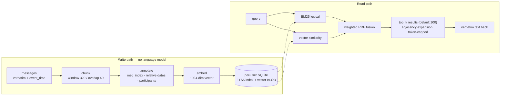

# Verbatim — a self-hosted memory service for AI agents

**Everything the agent was told, kept word for word. Retrieved by meaning, not by luck.**

逐字记忆 · 自部署的 Agent 长期记忆服务：**原文不摘要、只追加、可回放**，检索走关键词 + 向量双路融合。

[](LICENSE)

[](https://agentmemories.ai/competition)

Single process · FastAPI + SQLite · no external database, no orchestration layer, no vector service to operate.

---

## Why "verbatim"

Most agent memory systems compress. They summarize a conversation into a memory "card", embed the summary, and
serve it back later. That is cheap, and it quietly destroys the three things agents actually need:

- **numbers and names** — "the budget is 12,480" survives summarization far less often than "there was a budget";
- **who said what** — a summary merges two speakers into one voice, and preference questions stop being answerable;
- **when** — "last Saturday" is only recoverable if the original timestamp and the original wording are still there.

So this service takes the opposite bet: **store every message verbatim, append-only, and put the work into
retrieval instead of into rewriting.** Nothing in the write path generates text with a language model. The only
model in the running service is an embedding model, and it is used to *index* text, never to *replace* it.

The consequence is that a memory is a fact you can audit, not a paraphrase you have to trust.

## What it is / is not

| It is | It is not |
| --- | --- |
| An Add / Search HTTP API you deploy yourself | A hosted memory product |
| Verbatim, append-only storage with full provenance | A summarizing "memory profile" generator |
| Hybrid retrieval (BM25 + vectors, fused) | An LLM wrapper that answers questions for you |
| One container, one process, one directory of SQLite files | A cluster, a queue, or a managed vector DB |

## Quick start

```bash
git clone https://github.com/xiaomijituan/agent-memory-service
cd agent-memory-service
cp .env.example .env          # set AMC_MEMORY_SYSTEM_KEY and your embedding endpoint
docker build -t agent-memory-service:local .
docker run -d --name agent-memory-service \
  --env-file .env \
  -p 8080:8080 \
  -v "$PWD/data:/var/lib/amc/data" \
  agent-memory-service:local
curl --fail http://127.0.0.1:8080/healthz
```

Run it without any embedding provider and it stays fully lexical — set `AMC_EMBEDDING_MODE=off` and the service
makes no outbound calls at all. That mode is the default choice for air-gapped or evaluation-reproducible setups.

> The image runs as a non-root user and expects its data directory to be owned by uid `10001`.
> If you bind-mount a directory you created as root, `chown 10001:10001 <dir>` before the first start.

## API

Two write/read endpoints, plus two operational ones. Requests and responses are JSON; authentication is a single
header, `Authorization: Token <AMC_MEMORY_SYSTEM_KEY>`.

| Method | Path | Purpose |
| --- | --- | --- |
| `POST` | `/v1/memories/add` | write a batch of messages into one user/session namespace |
| `POST` | `/v1/memories/search` | retrieve verbatim chunks for a query |
| `GET` | `/healthz` | liveness plus dependency status |
| `GET` | `/version` | the frozen version fingerprint of this build |

**Write**

```bash
curl -X POST http://127.0.0.1:8080/v1/memories/add \
  -H "Authorization: Token $KEY" -H 'Content-Type: application/json' \
  -d '{
    "request_id": "demo-1",
    "user_id": "u_demo",
    "session_id": "s_demo",
    "messages": [
      { "role": "user", "content": "Our flight lands next Saturday.", "timestamp": 1684468800000 },
      { "role": "assistant", "content": "Noted — I will keep the itinerary." }
    ]
  }'
```

```json
{ "success": true, "request_id": "demo-1", "user_id": "u_demo", "session_id": "s_demo" }
```

**Read**

```bash
curl -X POST http://127.0.0.1:8080/v1/memories/search \
  -H "Authorization: Token $KEY" -H 'Content-Type: application/json' \
  -d '{ "request_id": "demo-2", "user_id": "u_demo", "query": "when does the flight land", "top_k": 5 }'
```

```json
{ "data": [ { "id": "…", "content": "Our flight lands next Saturday (2023-05-20).", "score": 0.0328, "created_at": "2023-05-18T12:00:00+00:00" } ] }
```

Message `timestamp` is Unix **milliseconds**; `role` accepts any non-empty string, because real agent transcripts
contain `system` turns that a memory system must not silently reject.

## How a memory is built and found



Three details carry most of the quality:

1. **Fusion, not either/or.** Lexical and vector rankings are merged with weighted reciprocal rank fusion
   (`RRF_CONSTANT = 60`), so an exact name match and a semantic near-match both get a say.
2. **Adjacency expansion.** A hit pulls in its neighbours in the same session, because the sentence after the
   answer is often the answer's condition.
3. **Time is rendered at read time.** `next Saturday` is stored with its event timestamp and expanded into
   `next Saturday (2023-05-20)` when it is returned — the original wording is never overwritten.

## Design decisions

| Decision | Why it is that way |
| --- | --- |
| Append-only, never summarize | A memory you cannot quote back is a memory you cannot debug |
| One SQLite database per user, spread over 256 hash-prefixed directories | Isolation for free: no cross-tenant leakage path, and a tenant can be deleted by file |
| Idempotency keyed on `request_id` | Retries are normal in agent runtimes; replay returns the stored bytes, a *different* payload under the same id is a `409` |
| `429` + `Retry-After` under load, not queue-unbounded | A caller that backs off recovers; a caller that times out retries and makes it worse |
| Single worker, in-process admission gate | Startup recovery assumes one process per data directory; that buys simplicity and needs a stated ceiling |
| Retrieval never calls an LLM | Latency, cost, and — most importantly — reproducibility of a benchmark run |
| FTS5 instead of a vector database | One file to back up, one process to reason about, and BM25 in the same query planner as the vectors |

## Configuration

Everything is environment-driven; see [`.env.example`](.env.example) for the full list. The values that change
behaviour rather than deployment:

| Variable | Default | Effect |
| --- | --- | --- |
| `AMC_AUTH_SCHEME` / `AMC_MEMORY_SYSTEM_KEY` | `token` | `none` disables auth — local development only |
| `AMC_ADD_CONCURRENCY` / `AMC_SEARCH_CONCURRENCY` | `8` / `2` | in-process admission caps |
| `AMC_ADMISSION_WAIT_SECONDS` | `10` | how long a caller waits before a `429` |
| `AMC_REQUEST_TIMEOUT_SECONDS` | `1800` | claim lifetime for an in-flight write |
| `AMC_EMBEDDING_MODE` | `api` | `off` = lexical-only, no outbound calls |
| `AMC_EMBEDDING_DIMENSIONS` | `1024` | must match your provider |
| `AMC_CHUNK_WINDOW_WORDS` / `_OVERLAP_WORDS` / `_STRIDE_WORDS` | `320` / `40` / `280` | chunk geometry |
| `AMC_FUSION_WEIGHT_LEXICAL` / `_VECTOR` | `1.0` / `1.0` | blend of the two retrieval legs |
| `AMC_MAX_OPEN_DBS` | `32` | open SQLite handles held at once |
| `AMC_SHAPE_PROBE` | `off` | optional caller-shape telemetry, for debugging an integration |

## Limits we measured, not guessed

Declared capacity for the evaluation deployment: **Add concurrency 8, Search concurrency 2, request timeout
1800 s, one request in flight per `request_id`.** `top_k` defaults to 100, which is also the upper bound the
evaluation contract allows — the service itself does not clamp it, so put your own ceiling on untrusted callers.
Storage grew to roughly 4 GiB for a full benchmark corpus on a 2 vCPU / 2 GiB host, with the container capped
at 1.5 GiB.

Two honest caveats:

- The admission caps are **per process**, and the service deliberately runs one process. Scale by giving each
  tenant its own instance, not by adding workers to one data directory.
- `DELETE` removes rows; it does not shrink the file. Reclaiming disk needs an explicit `VACUUM` or per-user
  file cleanup, which is a separate, authorized operation.

## Agent Memory Challenge 2026

This service was built for, and evaluated on, the **Agent Memory Leaderboard (AML)** platform hosted by the China
Society of Image and Graphics (CSIG) — Cycle 2, **textual track, commercial-product (industrial) leaderboard**.
A complete `Full` evaluation run finished in October 2026; official results, rankings and the award list are
published by the organizers, not here.

- Platform & leaderboard: <https://agentmemories.ai> · <https://agentmemories.ai/leaderboard/industry/textual>
- Competition page: <https://agentmemories.ai/competition>
- Rules: <https://agentmemories.ai/rules>
- Add / Search API contract expected by the platform: <https://agentmemories.ai/api-guide>
- Phase-2 FAQ (evaluation modes, quotas, model eligibility): <https://agentmemories.ai/blog?post=phase2-faq-20260920>
- Phase-2 supplementary Q&A (version registration, model disclosure): <https://agentmemories.ai/blog?post=phase2-faq-part2-20261022>
- Official dataset & benchmark repository: <https://github.com/AML-memory/agent-memory-leaderboard>
- Hugging Face: <https://huggingface.co/agent-memory-leaderboard>

Model disclosure, as the commercial track requires it in plain terms: the running service uses **one** model —
`text-embedding-v4` (1024-dim) via an online embedding API — for indexing and query encoding only.
**No LLM and no reranker model are used anywhere in Add or Search.** Answer generation and scoring during an
official run are performed by the platform's own models.

## Built by one person, with AI — and how that worked

This is a solo project: one designer, one implementer, one operator. It was built in roughly two weeks of
evenings with heavy agentic-AI use, and the method mattered more than the speed:

- **Test-first, always.** No product code landed without a failing test written before it. A change that could
  not be shown red-then-green was not merged.
- **Decisions in files, not in chat.** Every non-obvious choice became a numbered architecture record with its
  context and the option that was rejected — so an agent picking up the work tomorrow inherits the reasoning,
  not just the code.
- **One ledger for progress.** A single task list with evidence attached to each checked box was the only source
  of truth about what was done; "I think this part is finished" is not a status.
- **Parallel lanes with file ownership.** Several agents worked the same repository at once because each file had
  exactly one owner per task, and repo-wide commands belonged to the coordinating session only.
- **Measure, then claim.** Capacity, latency, recall and cost were profiled on the real deployment before any
  number was written into a submission. Several plausible-sounding designs were discarded because they did not
  move a measured metric — including a "discriminative evidence layer" that scored **worse** in ablation and was
  deleted.
- **AI wrote a lot of the code. A human owned every decision that could not be reverted.**

If you want to reuse the method rather than the code, the parts worth copying are the failing-test-first rule,
the architecture-record habit, and the refusal to ship an unmeasured claim.

## Repository layout

```
app/                 the service
  api/add.py         write path: validation, idempotent claim, chunk, annotate, embed
  api/search.py      read path: two legs, fusion, adjacency expansion, token cap
  store.py           per-user SQLite: schema, FTS5, vectors, transactions
  retrieval/         lexical.py · vector.py · fusion.py
  chunking.py        annotate.py        relative_dates.py     participants.py
  auth.py            concurrency.py     config.py             versioning.py
  health.py          retention.py       embedding.py          logging.py
deploy/              requirements.txt · sqlite_gate.py
tests/test_smoke.py  contract smoke test for a running instance
Dockerfile           non-root image, healthcheck, single worker
.env.example         every supported setting
```

## Security notes

- All endpoints except `/healthz` and `/version` require the bearer token; a missing or wrong token returns `401`
  and the response body never echoes the key.
- Log records contain identifiers (`request_id`, `user_id`, `session_id`), status and duration — never secrets.
- `.env` is git-ignored, and the repository ships only `.env.example`.
- There is no admin console, no user enumeration path, and no SQL string built from request text.

## License

Apache-2.0 — see [LICENSE](LICENSE).

Internal design documents, evaluation corpora and per-question result data are not part of this repository.
